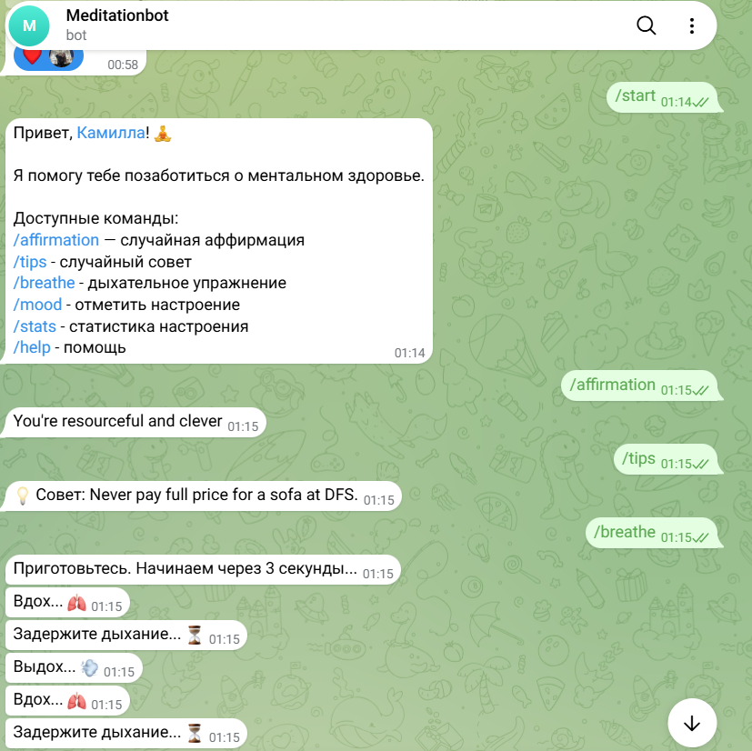
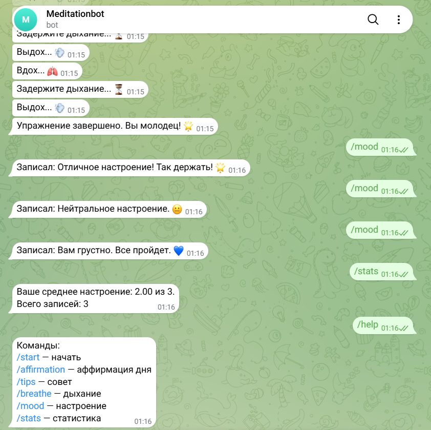

# Практическая работа № 2. Создание Telegram Bot 

**Автор:** Морозова Камилла Вячеславовна  
**Группа:** ПИ25-1  
**Дисциплина:** Практикум по программированию
**Дата сдачи:** 28.10.2026

## Описание проекта: Telegram-бот для медитации и ментального здоровья

Программа представляет собой Telegram-бота, направленного на поддержку ментального здоровья и помощь в снятии стресса.
Бот позволяет пользователю выполнять дыхательные упражнения, получать ежедневные аффирмации, проходить текстовые медитации и отслеживать свое эмоциональное состояние. Данные пользователя (настроение и прогресс) сохраняются в JSON-файл.

## Функциональные возможности

### Основной функционал
- Ежедневная аффирмация (выдача случайной позитивной фразы по команде)
- Дыхательное упражнение (пошаговая анимация в чате: «Вдох...», «Выдох...» с задержками по времени)
- Трекер настроения (выбор текущего состояния через инлайн-кнопки с эмодзи)
- Советы (случайный совет)
- Автосохранение истории настроений и оценок в JSON-файл

### Дополнительный функционал
- Текстовая медитация (выдача короткой инструкции, разбитой на несколько сообщений)
- Статистика настроения (подсчет и вывод среднего балла за последнюю неделю)

## Демонстрация работы программы

## Требования к системе
- **Python:** 3.9 или выше (так как используется `python-telegram-bot` версии 20+)
- **Операционная система:** Windows / macOS / Linux
- **Библиотеки:**
  - `python-telegram-bot` (основная библиотека для работы с Telegram API)
  - `aiohttp` (для асинхронных запросов к внешним API)
  - Стандартные библиотеки Python: `json`, `datetime`, `asyncio`, `logging`, `pathlib`

## Установка и запуск

### Клонирование репозитория (или распаковка архива)
git clone https://github.com/username/meditation-bot.git
cd meditation-bot
### Создание и активация виртуального окружения:
Windows:
python -m venv venv
source venv/Scripts/activate

macOS/Linux:
python3 -m venv venv
source venv/bin/activate

### Установка зависимостей
pip install -r requirements.txt

### Настройка токена бота
Откройте Telegram, найдите @BotFather, отправьте /newbot и получите токен.

В папке с проектом создайте файл config.py (если его нет) и вставьте туда токен:

BOT_TOKEN = "ВАШ_ТОКЕН_ЗДЕСЬ"

### Запуск программы
python bot.py

## Структура проекта

telegram_bot/
├── .gitignore
├── README.md
├── requirements.txt
├── config.py       
├── bot.py 
└── moods.json          # Файл с данными (создается автоматически)